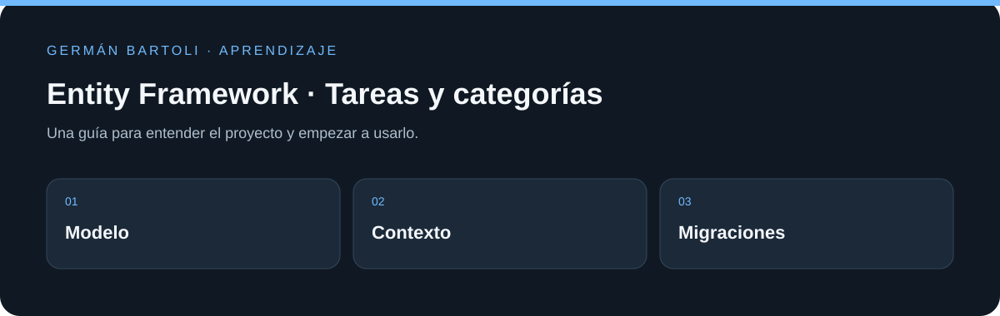

# Entity Framework · Tareas y categorías

**Proyecto de aprendizaje de Entity Framework con modelos de tareas y categorías y migraciones versionadas.**

[Empezar](#primeros-pasos) · [Mapa del repositorio](#mapa-del-repositorio) · [Autoría](#autoría-de-esta-documentación)

*Esquema de orientación; no representa una captura de la aplicación.*

## Primeros pasos

1. Abrí `ProyectoEF/ProyectoEF.sln` y revisá `Models/` y el contexto.
2. Prepará una base local y revisá las migraciones antes de aplicarlas.
3. Ejecutá el proyecto con un entorno compatible con `net7.0`; estudiá cómo el modelo se relaciona con las migraciones.

## Entorno de aprendizaje

Este repositorio conserva ejercicios y versiones de su etapa de estudio. Revisá los archivos de proyecto para preparar el SDK, runtime o servidor correspondiente; esta actualización del README no migra dependencias ni acredita una ejecución reciente de todos los ejemplos.

## Referencia y detalles

https://github.com/platzi/curso-fundamentos-entity-framework

## Mapa del repositorio

- [ProyectoEF/ProyectoEF.csproj](<ProyectoEF/ProyectoEF.csproj>)
- [ProyectoEF/ProyectoEF.sln](<ProyectoEF/ProyectoEF.sln>)
- [ProyectoEF/Program.cs](<ProyectoEF/Program.cs>)

## Autoría de esta documentación

Repositorio mantenido por [Germán Bartoli](https://github.com/GermanBartoli). Guía revisada y actualizada con **Codex**, coautor de esta actualización documental. Los autores, colaboradores, licencias y recursos de terceros conservan sus créditos originales.

Los commits de esta revisión incluyen `Co-authored-by: Codex <noreply@openai.com>`; esta atribución no modifica la autoría del historial anterior.
